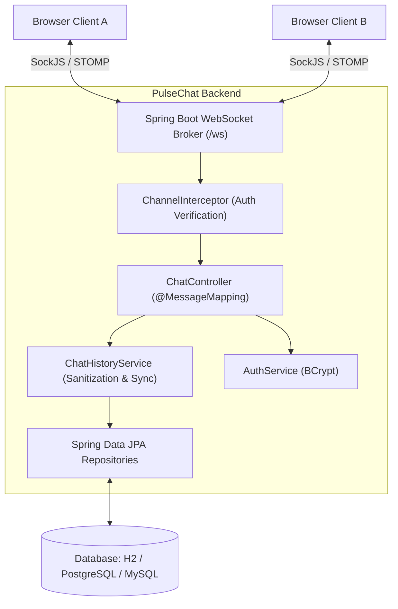
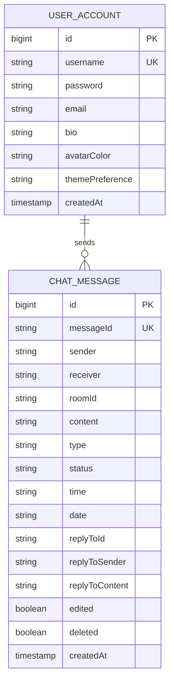

# PulseChat — Real-Time Messaging Platform

<div align="center">


[](https://spring.io/projects/spring-boot)
[](https://www.oracle.com/java/)
[](https://stomp.github.io/)
[](https://www.postgresql.org/)
[](https://www.docker.com/)
[](https://junit.org/)
[](LICENSE)

**A high-performance, real-time messaging application inspired by WhatsApp Web and Telegram Web, engineered with Spring Boot, STOMP WebSockets, and JPA.**

[Key Features](#-complete-features-matrix-56-feature-areas) • [Architecture](#-system-architecture) • [Getting Started](#-getting-started) • [Docker Deployment](#-docker--production-deployment) • [API & WebSocket Reference](#-api--websocket-reference) • [Database & Backups](#-database--backup-strategy)

</div>

---

## 🌟 Overview

**PulseChat** is a production-ready real-time communication platform built to demonstrate advanced full-stack engineering standards. It provides a split-pane interface with channel-based rooms, private direct messaging, message reactions, edits, deletions, quote replies, and an accurate 3-tier delivery receipt system (`✓` Sent, `✓✓` Delivered, `✓✓` Read/Acknowledged in blue).

---

## 📊 Complete Features Matrix (56 Feature Areas)

<details open>
<summary><b>1. Core Real-Time Messaging & Presence (1–23)</b></summary>

- **Real-Time Messaging**: Instant bidirectional event streaming via WebSockets and STOMP over SockJS.
- **Username Management**: Joining flow, empty validation, duplicate username rejection, case-insensitivity (`Azmath` == `azmath`).
- **Presence & Lifecycle**: Real-time join/leave system alerts, live online user count, green pulse status indicators, automatic disconnect cleanup.
- **Messaging Fundamentals**: Server-side HH:mm timestamps, left/right bubble alignment, distinct system notification styling, Enter-to-send, empty message rejection.
- **Typing Indicators**: Bouncing animated dots (*"adnan_khan602 is typing..."*) with auto-clearing upon message send or inactivity.
- **Private Direct Messaging**: Dedicated private routing, recipient validation, offline alerts, distinct purple styling.

</details>

<details open>
<summary><b>2. Phase 1 & 2: Messaging Improvements & UX (24–32)</b></summary>

- **24. 3-Tier Delivery Status**:
  - `✓` (Grey) — Message sent and confirmed by server.
  - `✓✓` (Grey) — Message delivered to recipient's device.
  - `✓✓` (Blue) — Message read / acknowledged by recipient.
- **25. 500-Character Counter**: Dynamic live counter (`0 / 500`) with warning and hard-stop states.
- **26. Day-Grouped Timestamps**: Centered date separator pills (**Today**, **Yesterday**, calendar dates).
- **27. Intentional Leave / Logout**: Clean STOMP disconnect, session reset, and broadcast.
- **28. Strict Username Validation**: 3–20 alphanumeric bounds, allowing `_` and `-`.
- **29. Responsive Design**: Adaptive layout supporting mobile, tablet, and widescreen desktop.
- **30. WhatsApp Themes**: Dark mode default + instant light mode switch with `localStorage` persistence.
- **31. Deterministic User Avatars**: Consistent color palette and initials generator based on username hash.
- **32. Web Notifications API**: Desktop notifications for incoming messages when window is inactive.

</details>

<details open>
<summary><b>3. Phase 3: Advanced Chat Capabilities (33–39)</b></summary>

- **33 & 34. Chat Channels & Creation**: Built-in rooms (`# General`, `# Java`, `# Spring Boot`) + modal to create custom channels broadcasted live via `/topic/rooms`.
- **35. Direct Message Panel**: One-click DM thread from online contacts list (`🔒 Direct Message with @User`) with instant return navigation.
- **36. Message Replies**: Quoted reply block referencing parent message with click-to-scroll navigation.
- **37. Emoji Reactions**: Interactive hover toolbar (`👍`, `❤️`, `😂`) with live count badges and user reaction toggling.
- **38. Message Editing**: In-place edits with validation, updating DOM with `(edited)` badges.
- **39. Message Deletion**: Real-time sender deletion, replaced with `🚫 This message was deleted`.

</details>

<details open>
<summary><b>4. Phase 4 & 5: Database, Security & Reliability (40–50)</b></summary>

- **40. Persistent Database**: Spring Data JPA with persistent embedded H2 file database (`./data/chatdb.mv.db`), seamlessly portable to PostgreSQL and MySQL.
- **41. Chat History**: REST endpoints (`/api/history/room/{roomId}`, `/api/history/private`) with automatic chronological recovery on room/DM switch.
- **42. Authentication System**: Card with **Sign In**, **Register**, and **Quick Guest** flows.
- **43. Password Hashing**: Industry-standard `BCryptPasswordEncoder` (strength 10).
- **44. User Profiles**: Profile storage (username, email, bio, preferences) with header profile modal.
- **45–47. Security & Interceptors**: HTTP session authentication, STOMP inbound channel interceptor blocking unauthorized private subscriptions, and private history access control.
- **48. XSS Sanitization**: Server-side `HtmlUtils.htmlEscape` before database storage and broadcasting.
- **49. Auto-Reconnect Recovery**: Exponential backoff reconnection handler (1s to 15s) with top reconnect banner and history resynchronization.
- **50. Centralized Error Handling**: `@RestControllerAdvice` returning structured JSON error envelopes.

</details>

<details open>
<summary><b>5. Phase 6: GitHub, Build & Deployment (51–56)</b></summary>

- **51. Git & GitHub Repository**: Clean repository setup, standardized `.gitignore`.
- **52. Professional Documentation**: System diagrams, setup guide, API and WebSocket reference.
- **53. Automated Test Suite**: 16 unit and integration test suites passing.
- **54. Production Dockerization**: Multi-stage `Dockerfile` and `docker-compose.yml`.
- **55. Production Configuration**: `application-prod.properties` and `.env.example`.
- **56. Database Deployment & Backup**: Automated bash (`backup-db.sh`) and PowerShell (`backup-db.ps1`) backup scripts with retention pruning.

</details>

---

## 🏛️ System Architecture

### WebSocket & STOMP Protocol Architecture



### Entity Relationship Diagram



---

## 🚀 Getting Started

### Prerequisites
- **Java 21** or later installed
- **Git** installed

### 1. Clone the Repository
```bash
git clone https://github.com/<your-username>/pulsechat.git
cd pulsechat
```

### 2. Run Locally with Maven Wrapper

**On Windows:**
```powershell
.\mvnw.cmd spring-boot:run
```

**On Linux / macOS:**
```bash
chmod +x mvnw
./mvnw spring-boot:run
```

### 3. Access PulseChat
Open your browser and navigate to:
```text
http://localhost:8080
```
- Data is automatically persisted to `./data/chatdb.mv.db`.
- H2 Console is available at `http://localhost:8080/h2-console` (JDBC URL: `jdbc:h2:file:./data/chatdb`).

---

## 🐳 Docker & Production Deployment

### 1. One-Click Launch with Docker Compose
PulseChat includes a complete multi-container setup with **PostgreSQL 16**:

```bash
# Copy environment variables template
cp .env.example .env

# Build and start PulseChat + PostgreSQL containers
docker compose up -d --build
```

Access the app at `http://localhost:8080`.

### 2. Standalone Container Build
```bash
# Build production image
docker build -t pulsechat:latest .

# Run container
docker run -d -p 8080:8080 --name pulsechat pulsechat:latest
```

---

## 📡 API & WebSocket Reference

### REST API Endpoints

| Method | Endpoint | Description | Auth Required |
|---|---|---|---|
| `POST` | `/api/auth/register` | Register new user account with BCrypt password | No |
| `POST` | `/api/auth/login` | Authenticate user and initiate session | No |
| `POST` | `/api/auth/logout` | Invalidate current user session | Yes |
| `GET` | `/api/auth/profile` | Retrieve profile of authenticated user | Yes |
| `PUT` | `/api/auth/profile` | Update profile information (bio, preferences) | Yes |
| `GET` | `/api/history/room/{roomId}` | Fetch chronological history for a room | No |
| `GET` | `/api/history/private` | Fetch chronological direct messages between 2 users | Yes |

### STOMP WebSocket Endpoints

| Destination | Type | Payload | Description |
|---|---|---|---|
| `/app/chat` | Send | `ChatMessage` | Send message to active room |
| `/app/private` | Send | `ChatMessage` | Send direct message to specific username |
| `/app/join` | Send | `ChatMessage` | Join presence announcement & registration |
| `/app/leave` | Send | `ChatMessage` | Disconnect presence notification |
| `/app/typing` | Send | `ChatMessage` | Broadcast typing indicator |
| `/app/react` | Send | `ChatMessage` | Toggle emoji reaction (`👍`, `❤️`, `😂`) |
| `/app/edit` | Send | `ChatMessage` | Update message content |
| `/app/delete` | Send | `ChatMessage` | Remove message content |
| `/app/ack` | Send | `ChatMessage` | Acknowledge delivery (`DELIVERED`) or read (`READ`) |
| `/app/room/create` | Send | `ChatMessage` | Create new channel room |

### Subscriptions

| Destination | Purpose |
|---|---|
| `/topic/public` | Global presence updates (`JOIN`, `LEAVE`, `USERS`) |
| `/topic/rooms` | Channel directory updates |
| `/topic/room/{roomId}` | Message stream for a specific channel room |
| `/topic/private/{username}` | Direct message inbox and delivery receipts |

---

## 🧪 Automated Testing Suite

PulseChat includes comprehensive unit, integration, and security tests:

```bash
# Run the complete automated test suite
./mvnw test
```

### Verified Test Cases (16/16 Passing)
- **`ChatControllerTest`**:
  - Message sending, length bounding (500 chars), and timestamp generation.
  - Username uniqueness, case-insensitivity, and length constraints.
  - Presence join/leave lifecycle and session detachment.
  - Private messaging routing and offline alerts.
  - Message reactions, edits, and deletions with ownership validation.
  - 3-tier delivery receipts (`SENT` -> `DELIVERED` -> `READ`).
- **`AuthAndHistoryServiceTest`**:
  - Registration with BCrypt hashing and duplicate username prevention.
  - Login verification and password match assertions.
  - Room and private chat history persistence, chronological sorting, and HTML escaping.
- **`ChatapplicationApplicationTests`**:
  - Full Spring Boot ApplicationContext load verification.

---

## 💾 Database & Backup Strategy

### Switching to MySQL or PostgreSQL

Set the environment variables in `.env` or pass them directly to the JVM:

#### PostgreSQL
```properties
SPRING_PROFILES_ACTIVE=prod
DB_URL=jdbc:postgresql://localhost:5432/pulsechatdb
DB_USERNAME=postgres
DB_PASSWORD=your_password
DB_DRIVER=org.postgresql.Driver
```

#### MySQL
```properties
SPRING_PROFILES_ACTIVE=prod
DB_URL=jdbc:mysql://localhost:3306/pulsechatdb?useSSL=false&allowPublicKeyRetrieval=true&serverTimezone=UTC
DB_USERNAME=root
DB_PASSWORD=your_password
DB_DRIVER=com.mysql.cj.jdbc.Driver
```

### Automated Database Backups

PulseChat includes automated backup scripts with a 14-day retention policy:

#### Linux / macOS (Bash)
```bash
# Execute manual backup
./scripts/backup-db.sh

# Schedule daily automated backup at 2:00 AM via cron
# Run: crontab -e
0 2 * * * /path/to/pulsechat/scripts/backup-db.sh >> /var/log/pulsechat_backup.log 2>&1
```

#### Windows (PowerShell)
```powershell
.\scripts\backup-db.ps1 -BackupDir ".\backups" -RetentionDays 14
```

---

## 📄 License

This project is licensed under the MIT License — see the [LICENSE](LICENSE) file for details.
